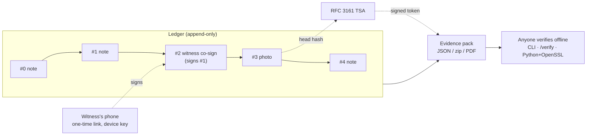

# Paper Trail

> Bukti yang tidak bisa kamu edit sendiri, bahkan kalau kamu mau.

Paper Trail is a tamper-evident evidence notebook for small disputes: unpaid overtime, a deposit a landlord will not
return, a freelance client who will not pay. You write down what happens as it happens; Paper Trail makes it
detectable if anyone, including you or us, later changes, deletes or backdates an entry, and lets anyone check that
without trusting Paper Trail.

**Status: v0.1.0, pre-alpha.** The evidence format is stable (SPEC 1.0); the software is not ready for real cases.
Read the [known limitations](CHANGELOG.md#known-limitations) first.

[Ringkasan dalam Bahasa Indonesia ↓](#ringkasan-bahasa-indonesia)

## The problem

People in small disputes usually have the weaker position and the worse records. Their notes live in a phone's notes
app, screenshots and memory, all of which are easy to dismiss: "you could have written that yesterday". Lawyers and
mediators cannot easily tell a contemporaneous record from one made up later, and the other side often has the HR
system, the contract and the timeline.

## Three mechanisms

1. **Hash chain.** Every entry includes the SHA-256 hash of the previous one. Changing, deleting, inserting or
   reordering any entry breaks every hash after it.
2. **Witness co-signs.** The owner sends a one-time link; a co-worker or neighbour opens it on their phone, without an
   account, and signs that specific entry with a key generated on their device (Ed25519, ES256 fallback). The signature
   becomes an entry in the chain.
3. **External time anchors.** The worker periodically sends the hash of the newest entry to an RFC 3161 time-stamping
   authority (TSA). The signed token proves the whole chain up to that entry existed by that time, so neither the owner
   nor the server can quietly move dates.

An export (an "evidence pack") contains the entries, signatures and tokens, and can be verified offline with the
`paper-trail-verify` CLI, the in-browser `/verify` page, or [just Python and OpenSSL](docs/VERIFY.md).



What it can show: an entry existed in this form by this time and has not changed since. What it cannot show: that an
entry is true, who really wrote it, or that nothing was left out. See [docs/THREAT_MODEL.md](docs/THREAT_MODEL.md).

## Quickstart (5 minutes)

Requirements: Node.js 22 (`.nvmrc`), pnpm 10 (`corepack enable`), Docker with Compose v2.

```bash
git clone <this repository> paper-trail && cd paper-trail
pnpm install
pnpm infra:up                                  # creates .env from .env.example; starts Postgres and RabbitMQ
pnpm --filter @paper-trail/api db:migrate      # schema and append-only triggers
pnpm --filter @paper-trail/worker db:role      # least-privilege database role for the worker
pnpm demo                                      # fictional demo ledger + packs in demo/
pnpm dev                                       # api :3000, worker, web :5173
```

Then open <http://localhost:5173>:

- **Owner app:** log in as `demo@papertrail.local` / `demo-lembur-2026` to see a 15-entry unpaid-overtime ledger with
  two witness co-signs and two anchors.
- **Verifier:** open <http://localhost:5173/verify> and upload `demo/demo-pack.json` ("Rantai utuh", chain intact),
  then `demo/demo-pack-tampered.json` ("Terputus di entri 3", broken at entry 3). Add `demo/demo-tsa-root.pem` as the
  TSA root to check the anchors' certificates too.
- **CLI:** `pnpm build && npx paper-trail-verify demo/demo-pack.json --roots demo/demo-tsa-root.pem`

The demo's anchors come from a local **mock TSA that proves nothing about real time**. For live anchoring you must pick
a real TSA and check its terms ([docs/OPERATIONS.md](docs/OPERATIONS.md#choosing-a-tsa)); for a local experiment, run
`pnpm --filter @paper-trail/worker mock-tsa` and put the values it prints in `.env`. The values in `.env.example` are
for local development only. Stop the infrastructure with `pnpm infra:down`.

**File uploads** (photos, documents) are stored in a local directory (`STORAGE_DIR`, default `.data/files`), so there is
no extra service to run. For several API hosts, switch to an S3-compatible store by setting the `S3_*` values instead
(the `minio/minio` image is no longer published; MinIO remains an opt-in compose profile `s3`).

## Repository layout

```
apps/api           Express API: accounts, ledgers, uploads, witness links, exports (JSON, zip, PDF)
apps/worker        RabbitMQ worker: RFC 3161 anchoring with retries and a dead-letter queue, reminders
apps/web           React + Vite: owner app, witness page (/saksi), verifier (/verify)
packages/chain     Pure format core: canonical JSON, hash chain, witness signatures, pack verification
packages/verifier  Offline verifier library and CLI (publishable to npm)
deploy/nginx       Production web server config with security headers
docs/              Specification, threat model, architecture, operations, security, examples
Dockerfile         Production images: --target api | worker | web | migrate
```

| Document                                         | Contents                                                   |
| ------------------------------------------------ | ---------------------------------------------------------- |
| [docs/SPEC.md](docs/SPEC.md)                     | The evidence format, version 1.0                           |
| [docs/THREAT_MODEL.md](docs/THREAT_MODEL.md)     | What is protected, from whom, and the honest limits        |
| [docs/ARCHITECTURE.md](docs/ARCHITECTURE.md)     | Components, flows and deployment                           |
| [docs/VERIFY.md](docs/VERIFY.md)                 | Verify a pack with only Python and OpenSSL; CLI exit codes |
| [docs/API.md](docs/API.md)                       | Owner-side HTTP API                                        |
| [docs/OPERATIONS.md](docs/OPERATIONS.md)         | Running it: TSA, queues, Docker images                     |
| [docs/SECURITY.md](docs/SECURITY.md)             | Reporting vulnerabilities; v0.1.0 security review          |
| [CONTRIBUTING.md](CONTRIBUTING.md)               | How to contribute                                          |
| [CHANGELOG.md](CHANGELOG.md)                     | Releases and known limitations                             |
| [docs/OPEN_DECISIONS.md](docs/OPEN_DECISIONS.md) | Undecided questions with recommendations                   |

Common scripts: `pnpm dev`, `pnpm build`, `pnpm lint`, `pnpm typecheck`, `pnpm test` (unit), `pnpm test:int`
(integration and chaos tests, needs `pnpm infra:up`), `pnpm --filter @paper-trail/web test:e2e` (browser tests,
needs Google Chrome), `pnpm demo`.

## Status and roadmap

v0.1.0 is a complete pre-alpha: every flow works end to end and is tested (unit, property-based, integration, chaos,
browser), but it has not been used for a real case, audited independently, or deployed in production.

Next, roughly in order:

1. Choose and document a production TSA (with its trust roots), and run a real deployment.
2. Email verification, password reset, a shared rate-limit store, session cleanup.
3. A policy for data deletion and privacy requests that respects the append-only chain.
4. Optional EXIF/GPS stripping for photos ([D7](docs/OPEN_DECISIONS.md)).
5. Server-signed receipts ([D6](docs/OPEN_DECISIONS.md)) and, if legal aides need it, witness identity options
   ([D5](docs/OPEN_DECISIONS.md)).
6. Review by Indonesian legal aides of how packs are presented; an independent security review.
7. English for the witness and verify pages.

## Comparison with similar products

Other tools help people document workplace problems. This comparison is based on a **limited search** (one web search
per product name on 2026-11-03, reading only each vendor's public pages; no product was tested), so it may be
incomplete or out of date. Corrections are welcome.

|                                      | Paper Trail                                                     | [WorkProof](https://workproof.me)                                         | [Spot](https://www.talktospot.com)                                                | IncidentLog ([iOS](https://apps.apple.com/app/id6756827780)) |
| ------------------------------------ | --------------------------------------------------------------- | ------------------------------------------------------------------------- | --------------------------------------------------------------------------------- | ------------------------------------------------------------ |
| What it is                           | Evidence notebook, open source, self-hostable                   | Commercial workplace documentation app with AI coaching                   | AI interview that produces a report; now mainly case management for organisations | Local, private incident logger app                           |
| Integrity of records                 | SHA-256 **hash chain** across all entries                       | SHA-256 hash per document; sealed entries cannot be modified              | PDF signed by the vendor (Palace Inc.), checkable in Adobe Reader                 | Audit log of edits; records can be edited or deleted         |
| Independent time proof               | RFC 3161 TSA token over the chain head                          | Bitcoin timestamps via OpenTimestamps (`.ots` files)                      | Vendor's signature and send log                                                   | Device timestamps                                            |
| Witnesses                            | Cryptographic co-sign from the witness's own device, no account | Witnesses recorded as part of a report                                    | –                                                                                 | –                                                            |
| Verify without the vendor            | Yes: CLI, browser, or Python + OpenSSL; open spec               | Yes for timestamps (any OpenTimestamps tool)                              | Signature check in a PDF reader; send log held by vendor                          | –                                                            |
| Extras it has that Paper Trail lacks | –                                                               | AI writing coach, rebuttal drafting, email backup, client-side encryption | Anonymous guided reporting into employer channels                                 | No account, no server, no data collection                    |
| Price                                | Free (Apache-2.0)                                               | Free for 3 entries, then one-time USD 29                                  | Not stated on the pages read                                                      | One-time purchase                                            |

**What is the same:** WorkProof is the closest; both hash records, anchor them to an external time source and produce
exports a third party can check. **What is different:** Paper Trail chains every entry to the previous one, so a
deleted or reordered entry is detectable, not only an edited one (WorkProof's pages describe per-document hashes and do
not say whether entries are chained); witnesses sign cryptographically; anchors use RFC 3161 (immediate, but you must
trust the TSA) rather than Bitcoin (no single trusted party, but confirmation takes hours); and the format, code and
verifier are open and self-hostable. Paper Trail has no AI features and no encryption at rest beyond what you deploy.
**QuietEvidence:** the search found only detective games by that name, no comparable product.

## Legal disclaimer

Paper Trail membantu membuktikan bahwa catatan tidak diubah setelah dibuat dan kapan catatan itu ada. Ini bukan nasihat
hukum dan tidak menjamin penerimaan sebagai alat bukti. Konsultasikan dengan pendamping hukum.

_(English: Paper Trail helps show that a record was not changed after it was made and when it existed. It is not legal
advice and does not guarantee acceptance as evidence. Consult a legal aide.)_

The legal weight of electronic evidence produced this way in Indonesian courts has not been verified by the project.

## License

Code and specification are licensed under the **[Apache License 2.0](LICENSE)**. Why Apache-2.0:

- **A format is only useful if others can check it.** A permissive license lets anyone (legal aid groups, courts'
  vendors, other apps) embed the verifier or implement the spec without asking, which is what makes a pack trustworthy
  independently of us.
- **Explicit patent grant.** Contributors grant a patent license for their contributions, so implementers of the spec
  are protected from patent claims by those contributors; MIT does not say this explicitly.
- **One license for spec and code** avoids confusion about whether the reference implementation and the document
  describing it can be used in the same way.
- **Attribution is kept:** redistributions must keep the copyright and [NOTICE](NOTICE).
- **The trade-off:** a company may run a closed, hosted fork. A copyleft license such as AGPL-3.0 would prevent that,
  but would discourage exactly the embedding that makes the format valuable. Adoption of the format was judged more
  important. This is a project decision, not legal advice.

## Ringkasan (Bahasa Indonesia)

**Paper Trail** adalah buku catatan bukti untuk sengketa kecil: lembur tidak dibayar, deposit sewa yang ditahan, klien
freelance yang tidak membayar. Kamu mencatat kejadian saat itu juga; setiap perubahan, penghapusan, atau pemunduran
tanggal sesudahnya, oleh siapa pun termasuk kamu dan kami, bisa ketahuan, dan siapa pun bisa memeriksanya tanpa harus
memercayai Paper Trail.

**Tiga mekanisme:**

1. **Rantai hash:** setiap catatan memuat sidik jari (SHA-256) catatan sebelumnya. Mengubah, menghapus, menyisipkan,
   atau menukar urutan catatan merusak rantai.
2. **Tanda tangan saksi:** saksi membuka tautan sekali pakai di ponselnya, tanpa akun, lalu menandatangani catatan
   tertentu dengan kunci di perangkatnya. Tanda tangan itu menjadi catatan di rantai.
3. **Jangkar waktu:** sidik jari catatan terbaru dikirim berkala ke otoritas cap waktu (TSA, RFC 3161). Token
   bertanda tangan membuktikan seluruh rantai sampai catatan itu sudah ada pada waktu tersebut.

**Coba dalam 5 menit:** ikuti [Quickstart](#quickstart-5-minutes), lalu masuk sebagai `demo@papertrail.local` /
`demo-lembur-2026` atau unggah `demo/demo-pack.json` dan `demo/demo-pack-tampered.json` di halaman `/verify`.

**Status:** v0.1.0, pra-alfa. Format bukti sudah stabil (SPEC 1.0), tetapi perangkat lunak belum siap untuk kasus
nyata. Belum ada TSA sungguhan yang dipilih; TSA tiruan di demo tidak membuktikan apa pun. Nama saksi ditulis oleh
saksi sendiri, dan catatan setelah jangkar terakhir belum punya bukti waktu dari pihak luar. Baca
[batasan yang diketahui](CHANGELOG.md#known-limitations).

**Lisensi:** Apache-2.0 untuk kode dan spesifikasi, supaya siapa pun bisa memeriksa dan membuat verifikator sendiri.

_Ini bukan nasihat hukum dan tidak menjamin penerimaan sebagai alat bukti. Konsultasikan dengan pendamping hukum._

## Author & License

Created by Vassel Goleyu. Copyright (c) 2026 Vassel Goleyu. Licensed under the Apache License, Version 2.0 (see
[LICENSE](LICENSE) and [NOTICE](NOTICE)).
