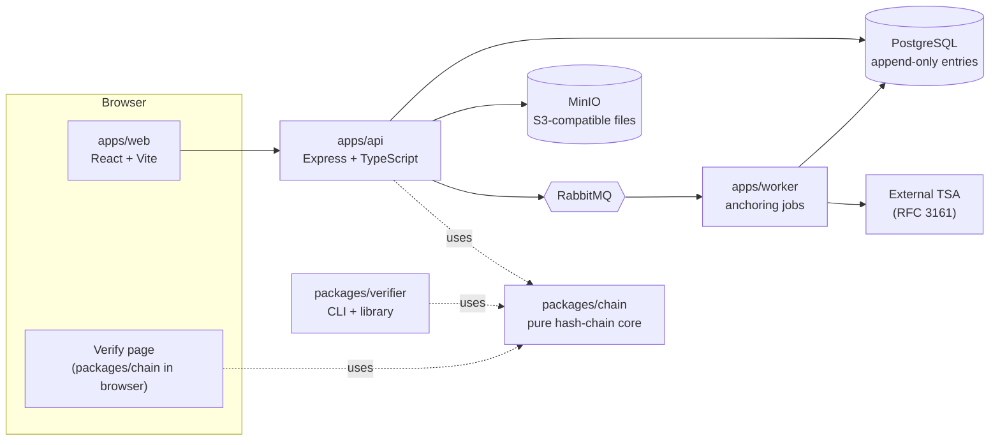
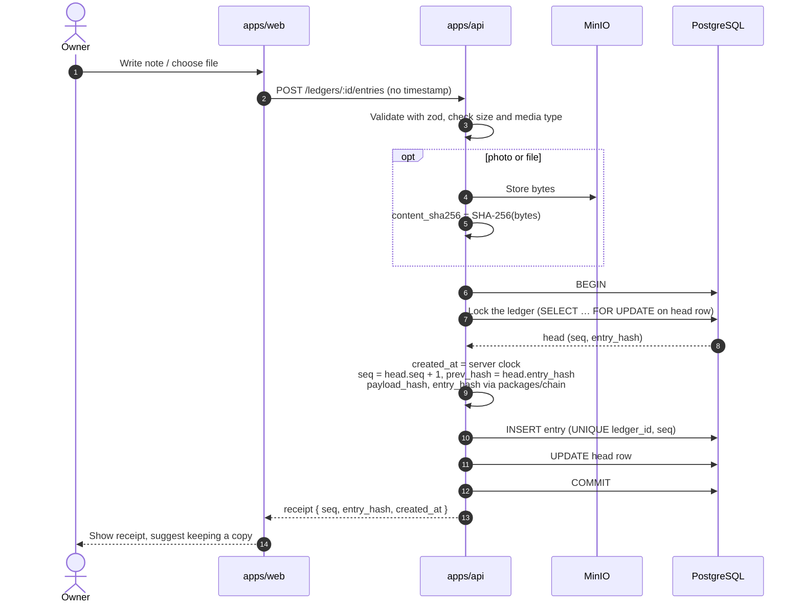
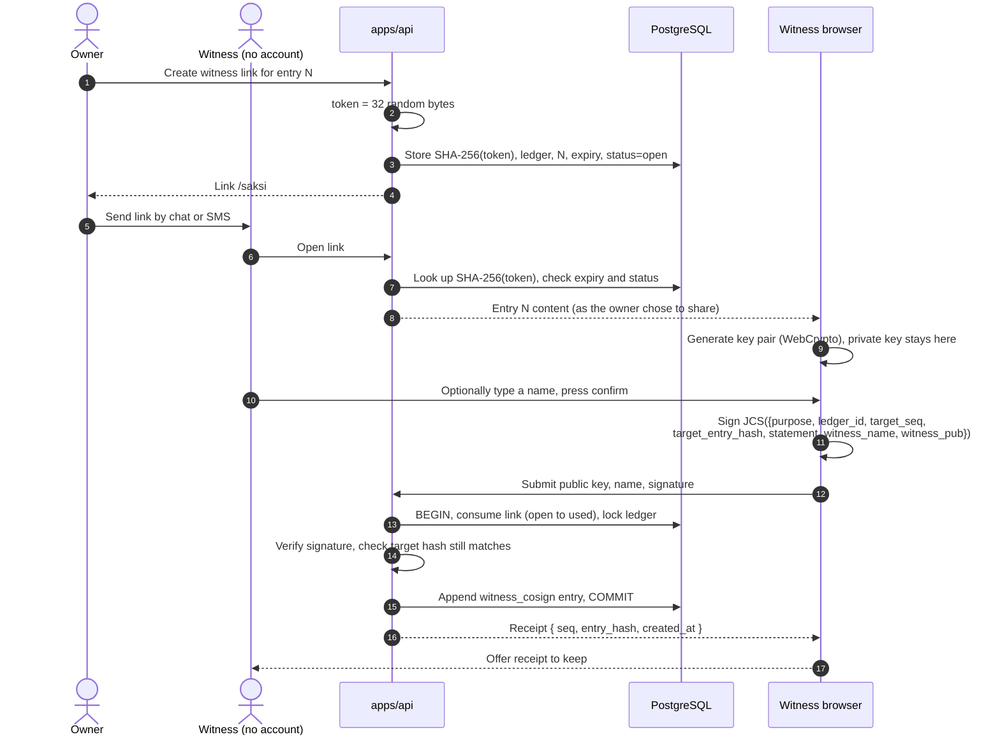
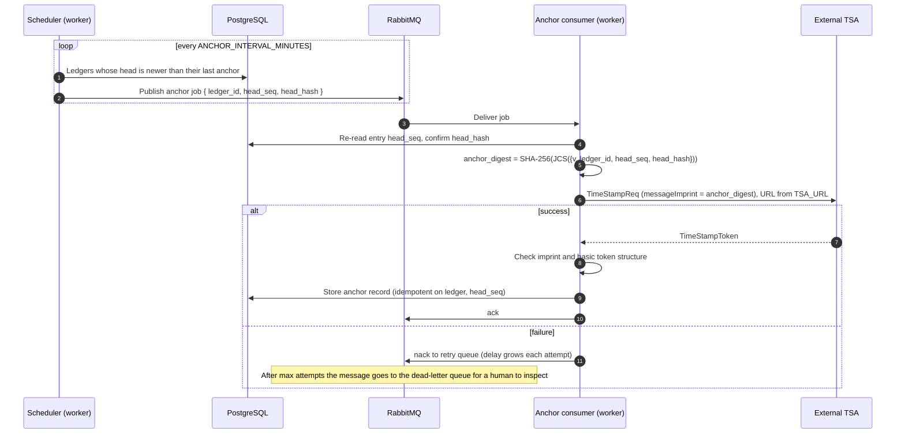
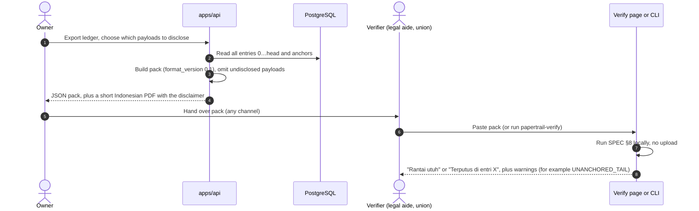

# Architecture

Status: draft v0.1, pre-alpha. The format itself is defined in [SPEC.md](SPEC.md); what the design does and does
not protect is in [THREAT_MODEL.md](THREAT_MODEL.md). Only the health check and the infrastructure exist today;
every flow below is the **planned** design.

## 1. Components

| Piece               | Responsibility                                                                                               |
| ------------------- | ------------------------------------------------------------------------------------------------------------ |
| `packages/chain`    | JCS canonicalization, SHA-256, entry/anchor/pack types, chain verification. No Express, no Prisma, no I/O.   |
| `packages/verifier` | CLI and library around `chain` plus TSA token checks. Runs offline.                                          |
| `apps/api`          | Auth, validation (zod), serialized appends, upload handling, witness links, exports. Only writer of entries. |
| `apps/worker`       | Consumes anchor jobs, calls the TSA, stores tokens. Never edits entries.                                     |
| `apps/web`          | Owner UI, witness page, public verification page. Indonesian UI.                                             |
| PostgreSQL          | Source of truth. `UPDATE`/`DELETE` on entries blocked by triggers; `UNIQUE(ledger_id, seq)`.                 |
| RabbitMQ            | Decouples slow or flaky external calls from requests. Retry, backoff, dead-letter queue.                     |
| MinIO / S3          | File bytes, addressed by `content_sha256`. Not part of the chain.                                            |

## 2. Flow: add an entry

Appends to one ledger are serialized so there is never a fork or a duplicate `seq`.

Implemented in `apps/api/src/services/ledger.ts` (`appendEntry`), the only code path that writes entries.
Fork prevention has three independent layers:

1. **Row lock.** `SELECT … FROM ledgers WHERE id = $1 FOR UPDATE` inside the transaction. Concurrent appends to
   the same ledger queue on it; each one reads the head only after the previous one committed, so it gets
   `seq + 1`. Appends to other ledgers lock other rows and are not blocked.
2. **Insert trigger** (`entries_check_link`). An entry with `seq > 0` is rejected unless entry `seq − 1` exists
   in the same ledger with `entry_hash = prev_hash` and an earlier-or-equal `created_at`. Gaps and dangling
   links are impossible even for code or SQL that skips `appendEntry`.
3. **`UNIQUE(ledger_id, seq)`.** Two entries can never share a position, so a fork cannot be stored.

The ledger head (`head_seq`, `head_hash`) is a cached pointer, not evidence; a trigger lets it advance only by
exactly one, to an entry that exists. Triggers reject `UPDATE`, `DELETE` and `TRUNCATE` on `entries`,
`attachments` and `witnesses`, freeze the anchored head of `anchors`, and stop re-targeting witness invites.
Integration tests (`ledger.int.test.ts`) cover 50 parallel appends, cross-ledger independence and each guard.

## 3. Flow: witness co-sign

A second use of the same link finds status `used` and fails. The plaintext token is never stored or logged.

## 4. Flow: periodic anchoring

Retries are safe because the job is idempotent: the anchor row is unique per `(ledger_id, head_seq)`. Entries
are never blocked on the TSA.

### Queue topology (proposed)

| Name                        | Role                                                       |
| --------------------------- | ---------------------------------------------------------- |
| `papertrail.anchor`         | Work queue for anchor jobs; dead-letters to the DLQ.       |
| `papertrail.anchor.retry.*` | TTL queues giving 1x, 2x, 4x… delays, dead-lettering back. |
| `papertrail.anchor.dlq`     | Parked jobs after max attempts; alert and manual replay.   |

## 5. Flow: export and verify

The verification page and the CLI share `packages/chain`, so there is one definition of "valid". Neither calls
our server. Trusting an anchor additionally needs TSA roots supplied to the verifier.

## 6. Runtime and local infrastructure

`docker-compose.yml` runs PostgreSQL, RabbitMQ (with the management UI) and MinIO, each with a healthcheck.
The apps run on the host with `pnpm dev`. `GET /health` on the API checks PostgreSQL and RabbitMQ and returns
`200 {status: "ok"}` or `503 {status: "degraded"}` with a per-dependency `up`/`down`, without error details.

## 7. Design decisions worth remembering

- **Chain logic lives only in `packages/chain`.** API, worker, CLI and verify page cannot disagree.
- **Server is the only clock.** Clients never send timestamps for hashed fields.
- **Integrity is enforced twice:** at the application and by Postgres triggers.
- **External calls are asynchronous.** The TSA going down must not stop people from recording evidence.
- **Verification is local.** A verifier should not need to trust, or even reach, our server.
